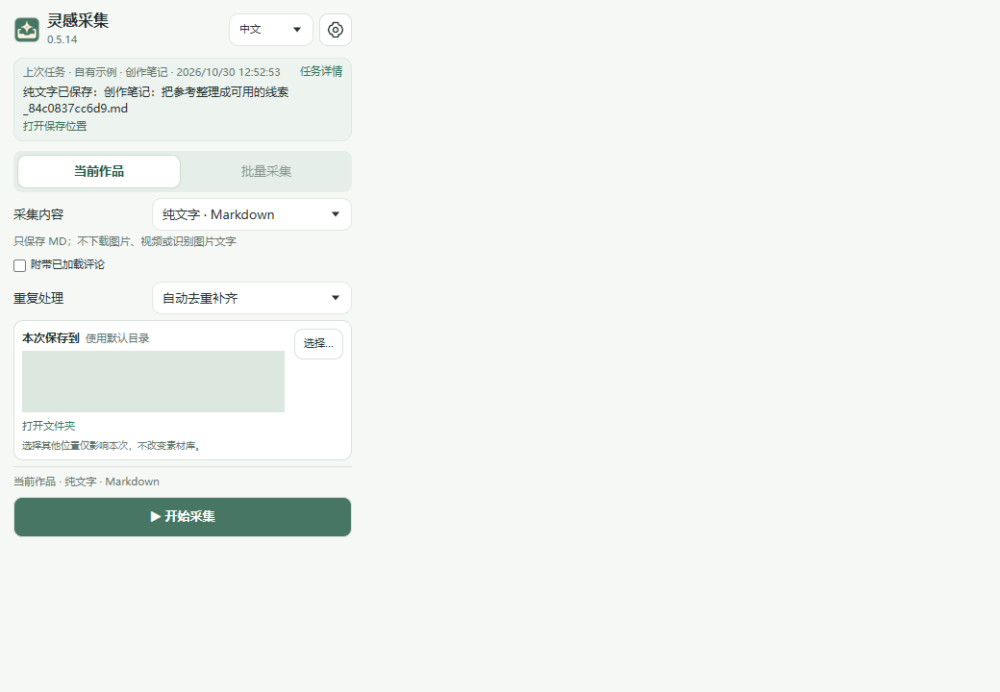

# First-time setup — InspiShelf 0.5.15

For Windows 10/11 x64 and Chrome. The desktop and extension still display **灵感采集 / Inspiration Collector**. Python and the media tools are included.

## 1. Choose the right download

Get `InspirationCollector-0.5.15-Windows-x64-Setup.exe` from [Releases](https://github.com/iiiiivy123/inspiration-collector/releases/latest). This is the recommended installer. `NoInstall.zip` includes the same runtime but must be extracted completely before use. GitHub's **Source code** archives and the smaller `user.zip` are developer packages, not ready-to-run apps.

The executable is unsigned. Verify the download source and SHA256 file; do not disable Windows security protection.

## 2. Start the desktop service

Open **灵感采集** from the Start menu or desktop. There is no main window: find the icon in the Windows system tray, including the **∧** hidden-icons area. Right-click it to open instructions, copy the extension folder path, or exit.

## 3. Add the extension once

1. In the tray menu, choose **复制扩展文件夹地址** (Copy extension folder path).
2. In Chrome's address bar, enter `chrome://extensions`. Enable **Developer mode**, then click **Load unpacked**.
3. In the folder picker, press **Ctrl+L**, **Ctrl+V**, then **Enter**. Click **Select folder**. Select the `extension` folder itself, not a file inside it or its parent.
4. A **灵感采集** card with its switch on means the extension is loaded. You may close this management page.
5. Use Chrome's puzzle-piece menu and pin the extension. From now on, open it from the toolbar while viewing the content you want to save.

If loading fails, check that the selected folder contains `manifest.json`. The default installation is `%LOCALAPPDATA%\Programs\InspirationCollector`, but use the actual path copied from the tray.

## 4. Choose a library and save

Click the toolbar extension. On first use, choose a long-term library folder in Settings. Changing it affects future tasks and does not move existing files. A temporary destination applies only to the current task.

Open an authorized content page and refresh it. Click the extension, select **Images**, **Markdown notes**, **Text only**, or an available video mode, and start. Text-only mode saves Markdown without images or videos; loaded comments are optional. Bulk support depends on the website and page type.

After completion, open the output folder. Saved items also appear in capture history, with the original output location. Failed or unfinished work appears under **Needs attention**.

## Updating, exiting and uninstalling

For **0.5.13 and earlier**, first right-click the tray icon and choose **退出灵感采集** (Exit). Then install the new version in place; no preliminary uninstall is needed. Newer compatible versions can exit safely when the installer requests it. Busy work blocks installation: finish or stop the task and retry.

After installing, reload the extension on `chrome://extensions` and refresh already-open content pages. Closing Chrome, the popup or this document does not stop the desktop service.

Uninstalling the app preserves your separate library and state under `%LOCALAPPDATA%\InspirationCollector`. The no-install ZIP uses that same state location; it is **not** a zero-footprint portable app. Do not run installed and no-install copies simultaneously.

## If something goes wrong

- **Cannot connect:** start the desktop app, check its tray icon, and reopen the extension.
- **Timeout:** check task history before starting again; the earlier operation may still be finishing.
- **Folder selection cancelled:** the previous location stays selected.
- **Video paused:** keep its control window open. Closing it or leaving it unresponsive beyond the 45-second lease stops unfinished downloads and removes their temporary files; saved files remain.
- **Old transient status expired:** completed status responses are retained for up to one hour, with at most 100 entries. Persisted history and saved files are unaffected. Open them from capture history.
- **Report a bug:** include app/extension versions, Windows/Chrome versions, steps and a redacted screenshot. Never share passwords, cookies, tokens, recovery codes, private configuration or your library.

The screenshot uses a self-authored local page; its test path is masked. Click **Open saved folder** after completion to open the actual result directory.

[中文教程](usage.md) · [Supported scenarios](use-cases-en.md) · [Third-party notices](third-party-notices.md)
