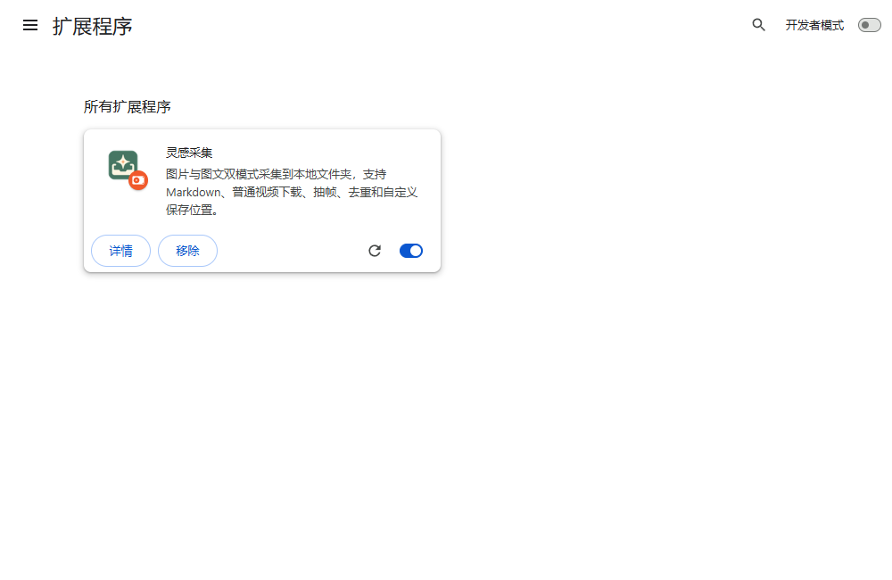

# InspiShelf（原“灵感采集”）使用说明 · Windows v0.5.15

本机测试版0.5.23：图片/图文模式可勾选“跳过动图（GIF／LIVE）”，默认关闭并记住选择；批量中明确跳过的视频或动图不占目标篇数。Instagram单篇混合帖可选择附带视频；清晰度选项仅在B站和YouTube显示。已保存的视频在作品、媒体与剪裁/输出参数一致且文件校验通过时可本地复用，新复用索引不追溯改写旧素材。浏览器日志保留200条，采集索引和正式素材不受此限。收藏夹与ArtStation作者批量暂未开放；网页需要登录、验证或字幕未能读取时仍可能部分失败。

**名称提醒**：InspiShelf 是对外展示名称，程序仍显示“灵感采集 / Inspiration Collector”。安装位置、素材库和配置目录保持兼容。[简明步骤](quick-start.txt) · [English](usage-en.md)

把你有权保存的网页图片、图文笔记和视频整理到自己的电脑；可在受支持的平台和模式中批量保存作者作品或画板内容，并从视频中提取画面。平台兼容范围和版权边界详见 [README](../README.md) 与 [版权、隐私说明](rights-and-privacy.md)。

**日常使用：打开桌面程序 → 打开目标网页 → 点击 Chrome 扩展 → 选择内容 → 开始采集。**


示例使用自有本地网页，路径已遮住。看到保存完成后，点击顶部的 **打开保存位置**，即可找到刚才保存的文件。下方“本次保存到”决定新任务的位置。

> **从 0.5.13 或更早版本升级：先在 Windows 托盘退出旧后台，再安装新版。** 支持安全退出的新版可由安装器请求空闲退出，忙碌时会阻止覆盖。关闭 Chrome 不等于退出后台。完整步骤见第 7 节。

## 1. 下载与安装

目前提供 Windows 10/11 64 位安装包，配合 Chrome 使用。安装包已内置 Python 和所需依赖，不需要自己安装或配置环境。

1. 打开 [下载页面](https://github.com/iiiiivy123/inspiration-collector/releases/latest)。
2. 在 **Assets** 下载 `InspirationCollector-0.5.15-Windows-x64-Setup.exe`。完整免安装版为 `NoInstall.zip`；Source code 和小体积 `user.zip` 需要自行配置环境。
3. **如果电脑已经安装过旧版，请先按第 7 节退出正在运行的「灵感采集」后台**，再双击安装包；全新安装可直接继续。按安装向导操作。
4. 打开桌面的 **灵感采集**。程序在后台运行，不会弹出主窗口；在 Windows 右下角系统托盘（可能收在向上的小箭头里）找到“灵感采集”。把鼠标停在图标上可查看名称。右键可打开本说明、打开或复制扩展文件夹、退出程序。

> 请下载 Windows-x64-Setup.exe，不要下载 Source code。
>
> 安装包尚未签名，Windows 可能提示未知发布者。只使用维护者提供的安装包；来源不明时不要运行，也不需要关闭杀毒软件。

## 2. 首次把扩展添加到 Chrome

这一步只需首次操作。桌面程序负责本地保存，Chrome 扩展负责读取你正在浏览的页面，两者都需要。

1. 右键 Windows 右下角的灵感采集托盘图标，点 **复制扩展文件夹地址**。这会复制实际安装位置，不要求你自己查路径。
2. 打开 Chrome，在地址栏输入 `chrome://extensions` 并回车，开启右上角 **开发者模式**，点 **加载未打包的扩展程序**（部分旧版 Chrome 称“加载已解压的扩展程序”）。
3. 会弹出系统文件夹选择窗口。在这个窗口按 **Ctrl+L → Ctrl+V → 回车**，再点 **选择文件夹**。选中的是 `extension` 文件夹本身，不是里面某个文件，也不是它的上一级。
4. 回到 Chrome，看到 **灵感采集卡片且开关已开启**，才表示加载完成。现在可以关闭这个扩展管理页面，以后不用每天重新加载。
5. 点击 Chrome 右上角 **拼图图标 → 灵感采集旁的图钉**，把它固定到工具栏。以后从工具栏的灵感采集图标打开使用；不需要回到扩展管理页面。

Chrome 中出现“灵感采集”卡片，才表示加载完成。**可选：**点击工具栏的拼图图标，将灵感采集固定，方便日常使用。



这是隔离测试浏览器中的实际扩展卡片。看到卡片后回到作品网页，从工具栏打开灵感采集开始使用。

如果粘贴出的不是扩展地址，说明剪贴板被覆盖了；重新从托盘复制地址即可。不能加载时，检查所选文件夹内是否包含 `manifest.json`。

如果安装时没有改路径，扩展通常位于：

```text
%LOCALAPPDATA%\Programs\InspirationCollector\extension
```

这只是未改安装路径时的备用位置；以托盘复制的实际地址为准。已经打开的目标网页，先刷新一次再采集。

**加载完成后：**打开想保存的作品网页，点击 Chrome 工具栏的灵感采集图标。第一次先按下一节选择素材库；之后从弹窗选择内容并开始采集。桌面程序负责保存，浏览器扩展负责读取页面，两个部分都需要。关闭本说明或 Chrome 扩展管理页不会停止后台服务。

## 3. 第一次选择素材库

1. 点击工具栏上的灵感采集图标。
2. 按首次使用提示进入设置；也可以点击弹窗右上角的齿轮。
3. 在 **素材库位置**中使用推荐位置，或点击 **更改素材库**，通过系统文件夹窗口选择位置。
4. 确认后，以后的新任务默认保存到这里。

建议选择空间充足、准备长期保留的目录，例如 `D:\灵感素材库`。

素材会按“功能 → 平台”整理：

```text
灵感素材库/
├─ 图片/小红书/作品标题/
├─ 图文/小红书/作品标题/
├─ 视频/小红书/作品标题/
└─ 批量/小红书/作者或画板/
```

以上为示例。平台名称和作品目录会随采集内容变化；批量同一作者或画板的内容放在一起，不再按图片、图文、视频拆开。

**更改默认素材库只影响以后的新任务，不会搬迁旧文件。** 历史记录和继续执行的旧任务仍沿用原保存位置。

### 只想这一次存到别处？

在采集弹窗底部的 **本次保存到** 卡片中：

- **选择…**：打开系统目录窗口，为本次任务选择其他位置，不改变长期素材库。所选位置下仍会按功能和平台分类。
- **恢复默认位置**：取消临时位置，重新使用素材库。
- **打开文件夹**：打开本次对应的功能／平台目录；目录尚未创建时，需要先完成一次采集。

普通采集偏好会沿用，临时保存位置不会作为下次的长期默认值。

## 4. 保存保存此页

先在 Chrome 登录目标平台，打开具体作品页面，再点击扩展。

| 想保存什么 | 怎么选择 |
| --- | --- |
| 作品图片 | **保存此页 → 采集内容：图片** |
| 正文和图片整理成笔记 | **保存此页 → 采集内容：图文笔记** |
| 只保存文字，不要图片视频 | **保存此页 → 采集内容：纯文字 · Markdown** |
| 视频文件 | **保存此页 → 采集内容：视频 → 仅保存** |
| 视频文件和提取的画面 | **保存此页 → 采集内容：视频 → 保存并抽帧** |

选择好后检查保存位置，点击底部主按钮。视频会先检查或估算大小，再由你确认下载；出现“等待下载确认”不代表卡住。

纯文字模式只输出 `.md`，不下载图片、视频或执行 OCR。前台的 **附带已加载评论** 默认关闭，可按需勾选并沿用。正文为空会提示失败，不生成空笔记；评论仅包含当前平台能识别的已加载部分。应用内部保留去重索引，笔记目录不放 JSON。纯文字使用带“纯文字”标识的独立作品／批量目录，不继承或删除旧图文附件。若手动修改过 MD，再次采集会另存，保留你的修改。

### B站视频

当前视频：打开具体 BV 稿件，播放后选择 **视频 → 仅保存／保存并抽帧**。

批量：打开 UP 主空间的 **投稿 → 视频** 列表，选择 **批量保存 → 视频**，填写视频数量；可选择保存并抽帧。每个投稿按默认第一 P 处理，不代表自动下载整套分 P 或合集。单视频地址中的 `p` 用于区分分 P。

只读取与当前稿件和 UP 主匹配的内容，跳过广告及推荐卡片；不自动删除视频画面里的口播或植入广告。优先选择页面已提供的兼容 AVC/AAC 清晰度，分轨会在本地合并；缺音轨、试看、未知格式或页面结构不匹配会报错，不保证最高付费画质，也不绕过登录或付费限制。B站不提供直接从网页播放器“仅抽帧”，请使用保存并抽帧。

Windows 包内置本地媒体组件，不需要另外安装。B站页面结构与视频格式可能影响采集；Reddit 尚未接入。

图文笔记保存为 Markdown 文件，可用文本编辑器或支持 Markdown 的笔记软件打开。图文选项中：

- **正文图片**：同时保存正文里的图片。
- **评论**：采集页面已经加载的评论，不代表平台上的全部评论。
- **图片文字识别**：使用本机 OCR 提取图片文字，结果可能需要人工校对。

图片／图文模式中的 **附带视频**决定遇到视频时如何处理。选择独立的视频模式后，使用“仅保存／保存并抽帧”，不需要再配置附带视频。

重复采集通常保留 **检查已有并补齐缺失** 即可：检查本地文件，补齐缺失内容，避免相同内容反复保存。**重新下载（原目录）**用于重新读取来源，不是删除重来；同一目标会复用原目录，并保留手动编辑内容。

## 5. 批量保存

1. 打开作者主页，或 Pinterest 的具体画板，而不是搜索结果或推荐首页。
2. 打开扩展，切换到 **批量保存**。
3. 选择图片、图文笔记或视频，设置本次数量。
4. 检查保存位置，点击开始；视频任务还需要确认下载。

**批量视频**：选择“视频 → 仅保存”。

**批量视频抽帧**：选择“视频 → 保存并抽帧”。

这两种视频任务只处理视频，图片帖会跳过，不占视频额度。一篇帖子里有多个视频时，按视频数量计算；重复或失败的视频也会占本次额度，因此设为 10 不保证新增 10 个文件。一次任务最多扫描 500 篇帖子，可能在找到足量视频前到达扫描上限。

采集期间请保持桌面程序运行，保留目标网页，不要切换它的地址。首次使用建议先试 2–3 篇，确认结果符合预期后再增加数量。

### 平台有什么区别？

| 平台 | 适合从哪里开始 |
| --- | --- |
| 小红书 | 单篇笔记或作者主页；支持图片、图文及视频相关模式 |
| X | 单帖或作者主页；批量按页面顺序采集本人帖子，不包含转帖 |
| Instagram | 单帖、作者帖子列表或 Reels 列表 |
| Pinterest | 当前 Pin 或具体画板；批量图文模式不提供 |
| 花瓣 | 当前采集及批量图片 |
| 其他网页 | 以当前页面图片采集为主，不提供通用批量能力 |

页面结构、登录状态及视频格式会影响结果。以弹窗实际可选的功能为准；某个模式可选不代表每个页面都能成功采集。

## 6. 查看结果、继续任务与重试

点击弹窗齿轮，进入管理页，再点击 **记录**。

### 采集记录

已保存的作品集中在这里。可以组合使用：

- 关键词：标题、作者或原链接；
- 分类：图片、图文、视频、批量；
- 平台：小红书、X、Instagram 等。

输入关键词后点击 **查询**。找到作品后可打开保存文件夹或原帖。记录保留实际保存位置；手动移动文件后，记录不会自动跟着更新。

旧素材未出现在记录中时，可展开 **导入或重新关联旧采集目录**，填写原目录，先预览再确认；这不会搬动素材。

### 待处理

这里只显示正在运行、未完成或有失败的任务，不重复列出全部成功任务。

- **回原页续采**：恢复未完成任务，回到原网页，再打开扩展确认继续。
- **只重试失败项**：只针对失败或部分失败的项恢复任务。
- 部分失败任务中已经成功的作品，仍可在采集记录里找到。

**“卡住时停止并重置”不是续采。** 它用于请求停止当前任务、清理残留状态；想接着采集，请使用续采入口。重置不能保证解决所有网页或系统卡死。

## 7. 更新与卸载

### 更新：旧版先退出，新版支持安全退出

**从 0.5.13 及更早版本升级，请先退出托盘后台。** 新版支持安全退出握手：安装器在后台空闲时请求退出并等待端口释放；正在采集时拒绝覆盖，先完成或停止任务后再试。不会自动卸载，也不会强杀任务。以下手动退出步骤仍可作为通用方法。仅关闭 Chrome 不会退出后台。

1. **完成或停止正在运行的采集任务。** 如果正在批量保存，先在扩展里停止或等待本轮结束，避免中途打断保存。
2. **找到托盘图标。** 看 Windows 任务栏右下角的通知区域。没有看到「灵感采集」，点击向上的小箭头 **∧** 展开隐藏图标，再把鼠标停在图标上确认名称。
3. **真正退出旧程序。** 在「灵感采集」图标上单击鼠标右键，选择 **退出灵感采集**。稍等片刻，确认图标消失。旧版 0.5.11 及更早版本若仍有“灵感采集已启动”的独立窗口，请按该版本的退出方式关闭它。
4. **再运行新版安装包。** 从 [GitHub Releases](https://github.com/iiiiivy123/inspiration-collector/releases/latest) 下载新的 Windows x64 `Setup.exe`，安装到**上次安装的位置**。通常**不必先卸载旧版本**，也不要删除你自己选择的素材库、历史记录或本地配置。
5. **确认本地后台已启动。** 安装向导可能在结束时启动程序；如果托盘里没有「灵感采集」，再从桌面或开始菜单启动一次。
6. **重新加载 Chrome 扩展。** 在 Chrome 地址栏输入 `chrome://extensions`，找到「灵感采集」扩展卡片，点击 **重新加载**（Reload）。已经打开的目标网页也请刷新一次，再打开扩展采集。

**如果安装器仍提示“灵感采集没有退出 / 程序正在运行”：** 先取消或关闭本次安装向导，重新检查右下角隐藏的托盘图标，选择 **退出灵感采集**，不要反复点击安装。如果图标不见了却仍报错，可以打开 Windows 任务管理器，核实是否仍有本软件的 `InspirationCollector.exe` 进程；**仅在确认进程属于本软件时**再考虑结束它。无法确定时可重启 Windows，且不要先启动旧版，之后重新执行安装。不要结束名称不明的进程。

**更新后文件在哪里？** 正常覆盖安装不会主动移动或删除你选定的素材库；历史记录仍指向原来的位置。更改保存路径也不会自动迁移旧文件。当前版本**没有自动更新**，每次获取新版本都需要手动完成上述步骤。

### 卸载

先停止任务并退出桌面程序，再从 Windows 的“已安装的应用”中卸载；Chrome 中的扩展需要另外移除。

卸载不会删除你选定的素材库，也不会删除独立保存的偏好和采集索引。保留这些数据是为了避免误删素材，不代表卸载后所有应用数据都会被清空。

## 8. 常见问题

**扩展提示连接不上服务？**

先打开桌面的灵感采集，查看右下角托盘图标。如果提示端口被占用，按上面的更新步骤退出旧版程序；不要随意结束不认识的进程。重复双击不会启动第二份后台。程序不默认开机自启，重启电脑后需启动一次；日常无需一直打开说明窗口。

**“加载已解压的扩展程序”失败？**

检查是否选中了安装目录中的 `extension` 文件夹，其中应有 `manifest.json`。不要选择安装包文件、源码 ZIP 或上一级目录。

**批量保存不能点？**

检查当前平台是否支持该模式，并先打开对应作者主页或具体画板。换到支持的内容类型后再试。

**视频没有立即开始下载？**

检查是否正在等待下载确认。大小未知不能理解成“没有大小”；抽帧还会额外占用磁盘空间。受保护或无法解析的视频可能不能下载。

**选择文件夹后弹窗关闭了？**

系统目录窗口可能使 Chrome 弹窗失去焦点。完成选择后重新打开扩展，检查“本次保存到”；取消选择不应改变原位置。

**图片文字识别不可用或不准确？**

OCR 依赖 Windows 本机识别组件和语言支持。可以先关闭图片文字识别保存其他内容；识别结果不保证与原文完全一致。

**明明采集成功，打开文件夹却找不到想看的文件？**

弹窗打开的是当前任务对应的目录。找以前的作品，请去采集记录中打开那条作品的文件夹；旧任务可能保存在之前的素材库位置。

**还没解决？**

向维护者提供扩展版本、平台、操作步骤和错误提示截图。提交反馈前请遮住个人路径、私密内容和账号信息，不要发送 Cookie、登录凭据或完整个人配置。

## 使用范围

仅保存你有权使用的内容，并遵守平台规则及权利人的授权。素材在本机保存，OCR 在本机处理；网页采集和下载仍需要访问来源网站。请勿将他人作品未经授权再次发布或用于商业用途。

网页改版、网络和格式差异可能导致采集失败，请依据提示处理。

内置媒体组件的来源、许可和重建说明位于安装目录的 `media-tools/README.md`，同目录包含许可和对应源码。仓库版本见 https://github.com/iiiiivy123/inspiration-collector/blob/main/docs/third-party-media.md 。使用边界与免责声明见安装目录的 `DISCLAIMER.md`。

## Contributors

普通使用者不需要下载源码或配置开发环境。

- [iiiiivy123](https://github.com/iiiiivy123)：项目维护、产品需求与使用反馈。
- **OpenAI Codex（AI 辅助贡献者）**：协助代码实现、界面调整、测试、文档和安装包制作；不是独立维护者或人工测试者。


### 0.5.15 试用版更新说明

安装 EXE 后，在 Chrome 扩展管理页重新加载原扩展，再刷新作品网页。扩展与后台版本不一致时会提示双方版本和更新步骤。不要删除原扩展，以免丢失浏览器内的偏好和本地任务记录。

「保存此页」用于单篇作品或普通网页；「批量保存」用于已适配的作者列表或画板。明确不支持的平台首页会禁用开始按钮。单页图片模式不附带普通视频；动图不因跳过普通视频而被跳过。批量的「遇到视频」控制普通视频；重复策略在设置页配置。

「检查已有并补齐缺失」会检查本地副本，已确认完整的批量作品跳过，缺失的重新处理；仅能确认上次已加载内容，不代表发现了作者新补的图片。「重新下载（原目录）」重新读取、下载，仍使用同一素材库和分类目录，内容相同的文件不会另存一份，不删除旧文件或手动修改的内容。更换素材库不会自动搬迁旧文件。

原生 GIF 保留原文件动画。X 的动图若由平台提供 MP4，则保留 MP4 动态源，不伪装为 GIF。小红书 LIVE 实况图本轮未完成支持；检测到时提示动态部分未完成，不把封面当作完整动图。普通网页已改进 Wiki 正文、小图、懒加载和广告排除，但不保证所有网站或广告结构均可识别。

待处理新增单页失败和开始阶段失败记录；这些补充记录保存在原 Chrome 扩展内。更新前没有记录下来的历史失败无法凭空恢复。


## 本机 0.5.22 补充

- 设置中的“每次任务图片上限”独立于批量篇数。0 不限；单页与整批共用，图片、GIF（包括重复和失败的尝试）计入额度。达到上限明确提示未处理项，不代表全部保存；继续原任务沿用额度，“重试失败项”作为新一轮重新计数。
- X / YouTube 使用已有 yt-dlp 下载引擎处理普通文件及原生支持的 HLS / DASH；清晰度预检与实际下载绑定同一组轨道。大小未知会如实显示，仍受文件上限约束。登录限制、直播和受保护媒体不在本轮支持范围。
- 视频输出统一为 MP4，画面 H.264、音频 AAC。兼容轨道直接复制；其他编码需要本地转码。音频模式仍是 M4A，不带字幕；GIF 仍是 GIF。
- YouTube 字幕按原语言作者字幕、原语言自动字幕、本地识别的顺序处理，不取翻译轨道。原语言无法确认时使用本地识别。仅文字稿只输出 MD；三件套仍输出视频、SRT、MD。
- ArtStation 本轮支持 `/artwork/作品编号` 单篇的已加载作品图片和说明，按作品归档；不抓推荐作品，不包含嵌入视频、3D 模型或作者主页批量。收藏夹批量留待后续。
